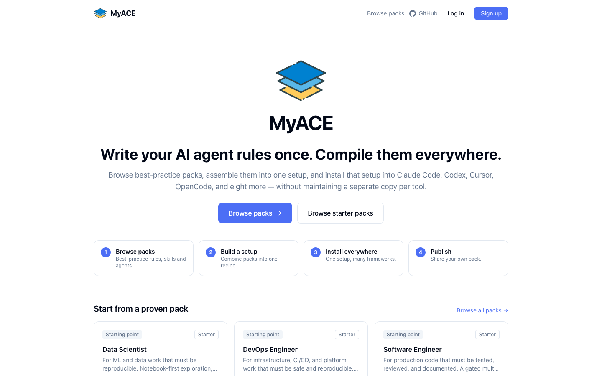
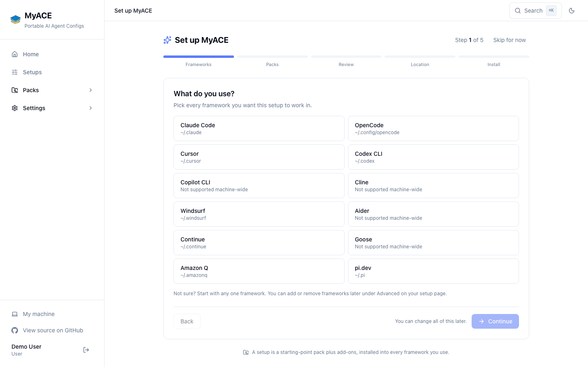
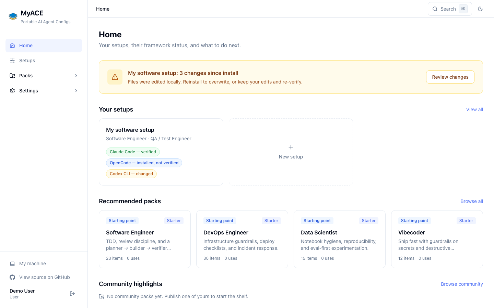
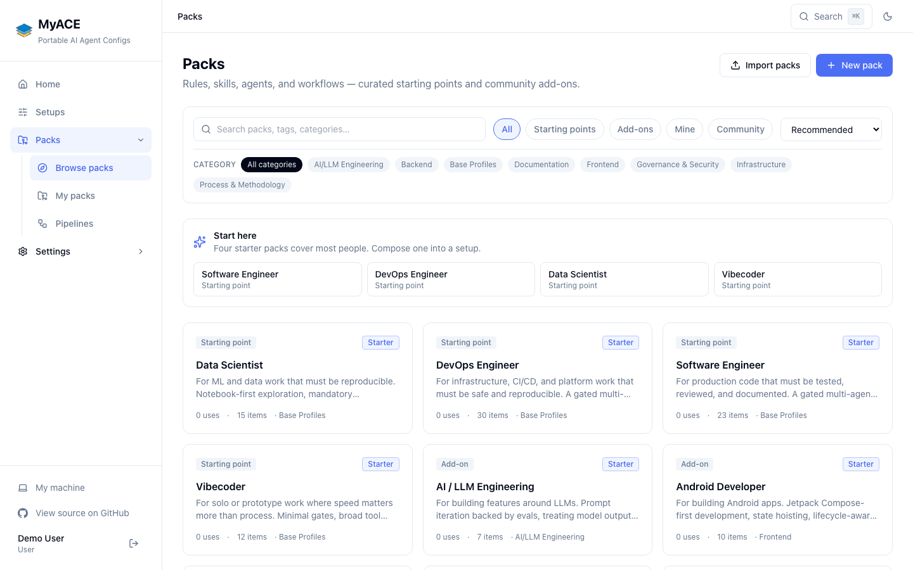
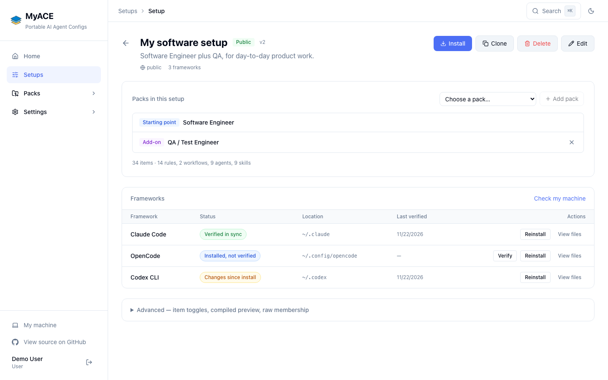
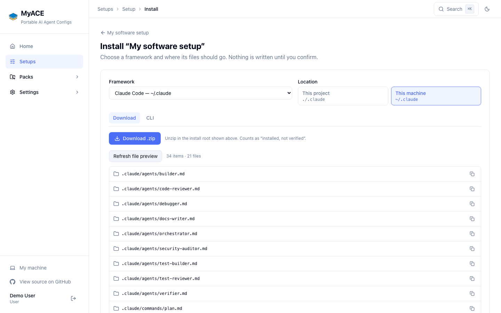
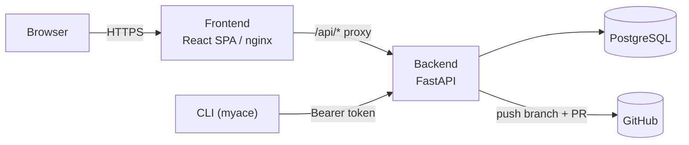

# MyACE — My Agentic Coding Environment

[](https://github.com/niels-emmer/myace/actions/workflows/ci.yml)
[](https://github.com/niels-emmer/myace/releases)
[](LICENSE)
[](backend/pyproject.toml)
[](frontend/package.json)

> **Built entirely by AI coding agents.** Every line of code, every test,
> every doc, and every infrastructure config in this repo was written by
> [Claude Code / Sonnet 5](https://docs.anthropic.com/en/docs/claude-code/overview)
> and [OpenCode / DeepSeek V4-Flash](https://github.com/niels-emmer/opencode) —
> reviewed, directed, and shipped by a human. If you're exploring what
> agentic coding can produce end-to-end, this is a working example.

## What it is

**MyACE makes your AI coding agent's rules, skills, and workflows portable.**
Write them once, keep them in one place, and compile them into whatever
format Claude Code, OpenCode, Cursor (and whatever comes next) actually
expects — instead of hand-maintaining N slightly-different copies, or
picking one tool and losing the rest. It's a portability layer for the
whole prompt-engineering stack: rules, skills, agents, workflows, and
model configs, managed as portable LLM tooling rather than per-framework
lock-in.

A live instance runs at **[myace.macjuu.com](https://myace.macjuu.com)** —
sign up and build your first setup in minutes, no setup required.

MyACE ships with **27 starter packs** (4 starting points + 23 add-ons)
holding **311 items** — 144 rules, 97 skills, 51 agents, 18 workflows,
and 1 model config — across **8 categories** and **166 tags**, and installs
to **12 target frameworks** (Claude Code, OpenCode, Cursor, Codex CLI,
Copilot CLI, Cline, Windsurf, Aider, Continue, Goose, Amazon Q Developer,
and pi.dev). You can start from scratch and build your own rules, import
governance from any
GitHub repo (or a local config directory) and turn it into a portable
pack, or browse the community library for ready-made content.

<table>
  <tr>
    <td width="50%"></td>
    <td width="50%"></td>
  </tr>
  <tr>
    <td width="50%"></td>
    <td width="50%"></td>
  </tr>
  <tr>
    <td width="50%"></td>
    <td width="50%"></td>
  </tr>
</table>

The storefront at `/welcome` and the **Packs** library at `/packs` are
browsable **without an account** — pack listings, detail pages, contents,
and each pack's aggregate rating are public read-only. Writing (rating,
commenting, using, installing, publishing) needs an account. The first
screenshot above is the anonymous storefront; the rest show the signed-in app.

## How it works

The app tells one story, everywhere: **browse packs → build a setup → install
to your frameworks → (optionally) publish**. A **pack** is a bundle of rules,
skills, agents, and workflows; a **setup** is your named recipe combining
packs; **installing** writes that setup into each framework's own layout; an
**item** is one rule, skill, agent, workflow, or model config.

If you've built up a set of coding conventions, review rubrics, or agent
personas you like, you've probably hit this: every framework wants them in
a different shape. OpenCode wants Markdown skill/agent/command files under
`.opencode/` plus an `AGENTS.md` and a JSON `opencode.json` for models/MCP.
Claude Code wants `CLAUDE.md` plus `.claude/agents/*.md`. Cursor wants
`.cursorrules` and `.mdc` files. None of that structure is really about the
*content* — it's packaging.

MyACE stores the content once, as Markdown with YAML frontmatter (the
**Canonical IR**), and translates it into each framework's native layout on
demand — from a web UI, or with a one-line CLI pull:

```yaml
---
type: rule | skill | agent | workflow | model_config
name: my-rule
version: 1.0.0
target_compatibility: [opencode, claude-code, cursor]
priority: 50
tags: [python, type-safety]
description: Enforces strict type annotations
---
# Rule Content

Markdown body — the actual instruction content.
```



A FastAPI backend owns the data and does all the real work; the React
frontend and the CLI are both thin clients of the same API. See
[docs/architecture.md](docs/architecture.md) for the full picture, including
the compilation pipeline, the Canonical IR's exact schema, and the auth
model.

## Features

### Packs, setups & installs

- **Install to any supported framework** — one click (or `myace pull`) turns
  a setup into the exact files 12 frameworks expect: Claude Code, OpenCode,
  Cursor, Codex CLI, Copilot CLI, Cline, Windsurf, Aider, Continue, Goose,
  Amazon Q Developer, and pi.dev. See
  [docs/adapters-research.md](docs/adapters-research.md) for each adapter's
  exact output format.
- **Import from anywhere** — scan a local config directory (`~/.claude`,
  `~/.config/opencode`, `~/.cursor`) or a GitHub repo, pick exactly which
  rules/skills/agents to bring in, and they become a portable **pack**.
- **Compose, don't copy** — a **setup** combines a starting-point pack with
  add-ons, layered by priority, with individual items toggled on or off — a
  named recipe you install per framework, not a duplicated file tree.
- **Edit items in place** — expand a rule, skill, agent, workflow, or
  model config on a pack's detail page and click its priority, version,
  target frameworks, or body to edit it directly, validated and auto-saved
  on blur. A right-aligned "Add rule" button adds a new rule without leaving
  the pack.

### Orchestrate

- **Pipelines & pipeline wizard** — agents can declare a `handoff_to` list
  describing which other agents they route work to; **Packs → Pipelines**
  (`/packs/pipelines`) turns that into a browsable set of multi-agent
  "recipes" with a flow diagram, and "Compose your pipeline"
  (`/packs/pipelines/new`) lets you assemble a new linear pipeline from an
  existing setup's agents and save it as a generated orchestrator agent — no
  hand-written frontmatter required.

### Public storefront & publishing

- **Browse before you sign up** — `/welcome` features proven starter and
  community packs, and `/packs` is a read-only library for signed-out
  visitors. The server exposes exactly five anonymous read routes (community
  list/top/categories, pack detail, pack contents), each approved-only and
  rate-limited per IP; see
  [ADR-0014](docs/adr/0014-public-pack-browsing.md). Everything that writes —
  using, rating, commenting, installing, publishing — still needs an account.
- **One pack page for every pack** — `/packs/:id` renders owned, starter,
  and community packs with the same header, actions (**Use this pack**,
  **Add to a setup…**, **Customize a copy**, and owner **Publish**), and
  Overview / Contents / Ratings & comments tabs. **Use this pack** creates a
  setup that references the pack (pairing an add-on with a starting point
  first when needed) and records the advisory use counter; **Add to a
  setup…** attaches the pack to one of your existing setups. Neither copies
  the pack — **Customize a copy** does.
- **Publish wizard** — `/packs/:id/publish` walks Select → Describe →
  Preview → Submit, writes metadata (including the optional SPDX `license`)
  and submits to the moderation queue. The pack page shows a
  **Draft → In review → Approved / Changes requested → Unpublished**
  tracker, with the moderator's reason when changes are requested. Publishing
  never changes `visibility`; that stays the separate Share control.

### Community

- **Community packs** — submit your packs for a moderator to review;
  approved submissions become public, browsable, and importable by other
  users. Rate (1-5 stars) and comment on published packs, sort the library
  by recommended/rating/recent, and opt into email notifications when your
  submissions get downloaded or commented on. "Used N times" is shown as a
  soft signal; it is not a ranking (the counter is user-incrementable).
- **Starter packs out of the box** — every fresh install seeds itself with 4
  starting-point packs (Vibecoder, Software Engineer, Data Scientist, DevOps
  Engineer) and 23 add-ons (Frontend, Backend, Database, QA/Test Engineer,
  Infrastructure as Code Expert, Azure, AWS, Google Cloud, and Scaleway Cloud
  Architect, Security Auditor, Documentation Editor, Full-Stack Developer,
  DevOps/Platform Engineer, Java/Spring Developer, iOS Developer, Android
  Developer, Spec-Driven Development, AI/LLM Engineering, EU AI Act
  Compliance, Git Practices, Design & Scaffold, Self-Hosted Deployment,
  Enterprise AI Governance), so there's real, opinionated content to build a
  first setup from on day one. This is a fixed, code-reviewed set maintained in
  [`collections/`](collections/) — separate from user-published community
  packs, and not affected by them.

### CLI & automation

- **A real CLI** — `myace login`, `myace pull`, `myace import --push`. Script
  it, put it in a dotfiles repo, run it on a fresh machine. See
  [docs/cli.md](docs/cli.md) for the full command reference.
- **Sync & drift detection** — `myace pull` writes a local manifest so
  `myace check`/`myace watch` can tell you whether a pulled-down setup has
  been hand-edited locally or gone stale against the server, with an opt-in
  `--report` to a personal sync report (`/machine?tab=sync`). A distributable
  [CI Action](docs/ci-drift-check.md) lets any repo that vendors compiled
  output fail its build on drift.

### Auth & admin

- **Real multi-user auth** — email+password (with email-based password
  reset) or OIDC/GitHub/Google SSO, optional TOTP two-factor authentication,
  private-by-default packs and setups with an explicit
  public/private flag, and user/moderator/admin roles for oversight. Not a
  toy single-user hack. See
  [docs/invariants.md#authorization](docs/invariants.md#authorization) for
  the exact rules.
- **Admin controls in the UI, no redeploy needed** — configure SMTP and
  OAuth provider credentials (Client ID/Secret, redirect URLs, a
  connectivity test button) from System Settings instead of editing `.env`;
  enable/disable target adapters and other users' accounts system-wide.

## Getting Started

### Prerequisites

- Docker & Docker Compose
- Python 3.12+ (for the CLI)
- Node.js 20.19+ (for frontend development — Vite 8's floor; CI and the
  frontend Docker image use Node 26)

### Quick Start

```bash
git clone https://github.com/niels-emmer/myace.git
cd myace

# 1. Configure environment
cp .env.example .env

# 2. Start the dev stack (hot reload, direct ports, home dir mounted for import)
docker compose -f docker-compose.yml -f docker-compose.dev.yml up -d --build

# 3. Run database migrations
docker compose exec backend alembic upgrade head

# 4. Access
#    Web UI:       http://localhost:80
#    API (direct): http://localhost:8000
#    API Docs:     http://localhost:8000/docs

# 5. Verify the API is up
curl -fsS http://localhost:8000/health
# {"status":"ok"}

# For Vite HMR during frontend development:
cd frontend && npm run dev   # starts on :5173, proxies /api to :8000
```

The first person to register an account automatically becomes an admin, as
long as `ADMIN_BOOTSTRAP_ENABLED` is still `true` (the default). If you're
planning to expose this beyond localhost, do that registration and then
turn `ADMIN_BOOTSTRAP_ENABLED` off before anyone else can — see
[docs/deployment.md](docs/deployment.md#fork-it-and-make-it-yours).

### Installing the CLI

The CLI ships as a standalone binary (no Python required) or via `pip`.
Full install instructions, the command reference, and the `myace import` /
`myace serve` workflows are in [docs/cli.md](docs/cli.md). The short version:

```bash
# MYACE_API_TOKEN is a token you create in the web UI's Settings → Account page
myace login --server https://myace.example.com --token "$MYACE_API_TOKEN"
myace --help
```

### Deploying it for real

Running it in production (single machine or behind a reverse proxy),
hardening a fresh fork, and configuring SSO/SMTP are all covered in
[docs/deployment.md](docs/deployment.md). Database backups are covered in
[docs/backups.md](docs/backups.md).

## Usage

The shortest path to the main workflows:

```bash
# Pull a setup into the local layout of the framework you use (the CLI flag stays --profile)
myace pull --profile "Software Engineer" --target claude-code

# See what would be written before committing to it
myace pull --profile "Software Engineer" --target cursor --dry-run

# Later: has the local copy been hand-edited, or gone stale on the server?
myace check --target claude-code
```

In the web UI the same install lives under **Setups → Install**
(`/setups/:id/install`): the setup is route-bound, so pick a framework and
location, then copy the files or download a zip. To turn existing rules into
a pack, use
**Packs → Import** (`/packs/import`) against `~/.claude`,
`~/.config/opencode`, or a GitHub repo. **My machine** (`/machine`) holds the
companion health check, setup audit, and per-framework sync report. Full command reference:
[docs/cli.md](docs/cli.md).

## Project Structure

```
├── AGENTS.md                    # AI agent maintenance guidelines
├── CLAUDE.md                    # Claude Code-specific agent guidance
├── API.md                       # HTTP API reference (canonical spec at /openapi.json)
├── CONTRIBUTING.md, SECURITY.md, CODE_OF_CONDUCT.md, LICENSE
├── docs/                        # Deep-dive documentation (humans + agents)
├── collections/                 # Starter-pack content (seeded on boot),
│   ├── base/                    #   hand-curated and code-reviewed here —
│   └── additional/              #   see "Starter packs" section in AGENTS.md
├── docker-compose.yml           # Single-machine production
├── docker-compose.dev.yml       # Dev overrides (ports, mounts, CORS)
├── docker-compose.prod.yml      # VPS overrides (external network, no ports)
├── .env.example
│
├── backend/                     # FastAPI + SQLModel
│   ├── Dockerfile
│   ├── pyproject.toml
│   ├── alembic.ini
│   ├── alembic/                 # Migrations
│   ├── app/
│   │   ├── main.py              # App entrypoint, CORS + session middleware
│   │   ├── core/                # Config, DB session, OIDC/security, crypto (encrypted admin secrets), deps (auth), authz (ownership checks)
│   │   ├── models/               # SQLModel schemas (User, Collection, CollectionComment, CollectionRating, Artifact, Profile, ApiToken, DocCache, SyncStatus, SystemSettings)
│   │   ├── api/                  # Routes: auth, collections, comments, ratings, profiles, adapters, doc_cache, admin, moderation, sync, demo (public), freshness
│   │   ├── adapters/             # Canonical IR → target translators (12: Claude Code, OpenCode, Cursor, Codex CLI, Copilot CLI, Cline, Windsurf, Aider, Continue, Goose, Amazon Q, pi.dev)
│   │   └── services/             # Compiler, doc verifier, scanner (local + git), github_export, seed_collections,
│   │                              #   email (SMTP send), effective_settings (DB-override-vs-env resolver)
│   └── tests/                    # pytest suite
│
├── frontend/                    # React + Vite + TailwindCSS
│   ├── Dockerfile
│   ├── nginx.conf
│   ├── package.json
│   ├── src/
│   │   ├── components/           # Layout (four-area sidebar, 52px top bar, ⌘K palette), PublicLayout
│   │   │                          #   (anonymous storefront shell), CommandPalette, SectionHub,
│   │   │                          #   PublishStatusTracker, TargetChecklist, shared UI
│   │   ├── contexts/              # AuthContext (current user/session), ThemeContext (light/dark/system)
│   │   ├── pages/                 # Landing (public /welcome storefront), Login, ResetPassword, Home,
│   │   │                          #   PacksLibrary (public browse for signed-out visitors), PackDetail (unified
│   │   │                          #   owned/starter/community), PublishPack (four-step wizard), CollectionsManager
│   │   │                          #   (My packs), CollectionDetail (owner manage at /packs/:id/manage),
│   │   │                          #   NewArtifactRule (add a rule), ProfileComposer (Setups), ProfileDetail,
│   │   │                          #   OrchestrationGallery (Pipelines), OrchestratorBuilder, TargetExporter (Install),
│   │   │                          #   MachinePage (tabbed Overview/Audit/Sync) wrapping SetupAudit and
│   │   │                          #   SyncDashboard; ImportPage (Packs → Import), SettingsHub, UserSettings (Account),
│   │   │                          #   ModerationQueue (moderator/admin-gated), SystemSettings (admin-gated)
│   │   ├── lib/                   # API client, packApi.ts (anonymous storefront reads + use/metadata),
│   │   │                          #   navigation.ts (sidebar + breadcrumbs — AGENTS.md #38),
│   │   │                          #   bundles.ts (curated starter bundles), packs.ts (pack badges/links/frameworks)
│   │   └── types/                 # TypeScript interfaces (packs.ts holds storefront/publish-only shapes)
│   └── dist/                     # Production build
│
├── cli/                          # Python Typer CLI
│   ├── pyproject.toml
│   └── myace_cli/
│       ├── main.py               # Entrypoint (9 commands: login, logout, status, pull, check, watch, serve, list-profiles, import)
│       ├── auth.py               # Credential storage
│       ├── sync.py               # Profile fetch + write
│       ├── scanner.py            # Local directory scanner
│       └── adapters/             # Client-side translation fallbacks
│
├── scripts/                      # bootstrap-import (binary installer), docs→Wiki sync,
│                                 #   README structure check
└── .github/                      # Issue/PR templates, CI workflows, Dependabot config
```

### Documentation map

| Document | What it covers |
|---|---|
| [`API.md`](API.md) | The HTTP API — base URL, auth, route groups, curl examples. Canonical spec served at `/openapi.json` |
| [`docs/architecture.md`](docs/architecture.md) | Components, compilation pipeline, canonical IR, auth model |
| [`docs/data-model.md`](docs/data-model.md) | Every table, its columns, and how they relate |
| [`docs/invariants.md`](docs/invariants.md) | Rules the system must never violate, and where they're enforced |
| [`docs/extending.md`](docs/extending.md) | How to add an adapter, artifact type, SSO provider, or route |
| [`docs/deployment.md`](docs/deployment.md) | Forking, hardening, and running in production (single machine or behind a reverse proxy) |
| [`docs/cli.md`](docs/cli.md) | Installing and using `myace`: commands, `import`, `check`/`watch` drift detection, the local companion server |
| [`docs/ci-drift-check.md`](docs/ci-drift-check.md) | The distributable `myace-check` GitHub Action for other repos to fail CI on sync drift |
| [`docs/backups.md`](docs/backups.md) | Database backup retention, offsite copy, and restore procedure |
| [`docs/debugging.md`](docs/debugging.md) | Known gotchas — symptom, cause, fix |
| [`docs/adapters-research.md`](docs/adapters-research.md) | Every adapter's confirmed file format, doc citations, and unbuilt candidates |
| [`docs/adr/`](docs/adr/) | Architecture Decision Records — why the non-obvious choices were made |
| [`AGENTS.md`](AGENTS.md) / `CLAUDE.md` | Rules and conventions for AI coding agents working in this repo |

`docs/` is written for both humans and AI coding agents — start there for
anything deeper than "how do I run this."

## Roadmap

MyACE doesn't yet cover every AI coding tool, and a couple of pieces of the
existing pipeline are known to be incomplete:

- **More adapters** — Zed AI and CodeGPT are viable, unbuilt
  candidates; Windsurf's adapter still targets its legacy path rather than
  the Devin Desktop rebrand, and Amazon Q Developer could emit its newer
  native agent format. Full detail (plus what's already been evaluated and
  rejected — Roo Code, Sourcegraph Cody) is in
  [docs/adapters-research.md#future-plans](docs/adapters-research.md#future-plans).
- **`myace pull` has no offline fallback** — three adapters are mirrored
  client-side in `cli/myace_cli/adapters/`, but `myace pull` doesn't call
  into them yet, so it always needs a reachable server today. See
  [docs/architecture.md#adapters](docs/architecture.md#adapters).
- **No install URL an agent can fetch** — today a pack or setup reaches a
  machine only as a `.zip` download, via `myace pull`, or through the local
  companion's direct apply (which does write files for you, but needs
  `myace serve --allow-apply` running on that same machine) — so every path
  needs a browser session, a CLI login, or a local service already running. A
  public, agent-readable URL (for example
  `GET /api/v1/collections/community/{id}/install.md?target=…`) would let
  someone paste one link into any coding agent and have it install the pack.
  This has been researched and scoped but not built; the design, payload
  format, and the three gaps blocking it are written up in
  [docs/plans/agent-install-url.md](docs/plans/agent-install-url.md).

If you use a framework not listed above, or want to pick up an open item,
see [Contributing](#contributing-and-forking) below — an issue or PR is
the way to propose it.

## Contributing and Forking

Bug reports, feature requests, and PRs are welcome — see
[`CONTRIBUTING.md`](CONTRIBUTING.md) for the development setup, conventions,
and PR process. Please read [`CODE_OF_CONDUCT.md`](CODE_OF_CONDUCT.md) too.

Found a security issue? Please don't open a public issue — see
[`SECURITY.md`](SECURITY.md) for how to report it privately.

MyACE is equally designed to be **forked and self-hosted** — run your own
instance, or use the hosted one at [myace.macjuu.com](https://myace.macjuu.com).
See [docs/deployment.md](docs/deployment.md) for the checklist to work
through before exposing a fork beyond localhost.

A few things worth knowing as either a contributor or an operator running
their own fork:

- **Schema changes** ship as Alembic migrations
  (`docker compose exec backend alembic upgrade head` to apply). Every
  migration has a working `downgrade()` — see
  [`AGENTS.md`](AGENTS.md#2-database-migration-rules).
- **CI** ([`.github/workflows/ci.yml`](.github/workflows/ci.yml)) runs
  lint, type-check, and tests for the backend, CLI, and frontend on every
  PR, plus a Docker build check.
- **Dependabot** ([`.github/dependabot.yml`](.github/dependabot.yml)) opens
  weekly PRs for backend/CLI (pip), frontend (npm), Docker base images, and
  GitHub Actions themselves, grouping minor/patch bumps but leaving each
  major-version bump as its own PR (see
  [docs/debugging.md](docs/debugging.md) for why that split matters).
- **Documentation moves in the same PR as the code it describes** — see
  [`AGENTS.md`](AGENTS.md#14-documentation-maintenance).

### Testing

Run the suites with `pytest` in `backend/` and `cli/`, and `npm run test` in
`frontend/`; `npm run dev`, `npm run build`, `npm run lint`, and
`npm run preview` are the other frontend tasks. Exact setup, plus the `ruff`,
`mypy`, `tsc`, and `eslint` commands, is in
[`CONTRIBUTING.md#running-checks-locally`](CONTRIBUTING.md#running-checks-locally);
CI runs all of them on every PR.

## Acknowledgements

MyACE is built on [FastAPI](https://fastapi.tiangolo.com/),
[SQLModel](https://sqlmodel.tiangolo.com/), [Alembic](https://alembic.sqlalchemy.org/),
[Authlib](https://authlib.org/), [React](https://react.dev/),
[Vite](https://vitejs.dev/), [TanStack Query](https://tanstack.com/query),
[Tailwind CSS](https://tailwindcss.com/), and [Typer](https://typer.tiangolo.com/).
Thanks to the maintainers of all of them.

Some starter-pack collection content draws on patterns and principles from
the wider open-source agentic-coding community, credited here rather than
copied verbatim into the artifacts themselves:

- The `spec-driven-dev` collection adapts the spec → clarify → plan → tasks
  → analyze → implement workflow popularized by GitHub's
  [spec-kit](https://github.com/github/spec-kit) (MIT).
- The `ai-engineering` collection's `agent-design-principles` skill is
  grounded in [12-factor-agents](https://github.com/humanlayer/12-factor-agents)
  (HumanLayer, Apache-2.0).
- Gap analysis for both collections cross-referenced
  [wshobson/agents](https://github.com/wshobson/agents) (MIT) and
  [VoltAgent/awesome-claude-code-subagents](https://github.com/VoltAgent/awesome-claude-code-subagents)
  (MIT) against this repo's existing agent/skill lineup.

Logo: <a href="https://www.flaticon.com/free-icons/layers" title="layers icons">Layers icons created by Good Ware - Flaticon</a>.

This entire project — every line of code, every test, every doc, every
infrastructure config — was written by AI coding agents (see the note at
the top of this README).

Incoming PRs are also reviewed by **Marvin** ([`marv-o-matic`](https://github.com/marv-o-matic)),
an automated AI review bot that checks CI status, verifies README/count claims
and code changes against source, and flags risks — comment-only unless a human
explicitly asks it to push a change.

## License

[MIT](LICENSE) © 2026 [Niels Emmer](https://github.com/niels-emmer)
