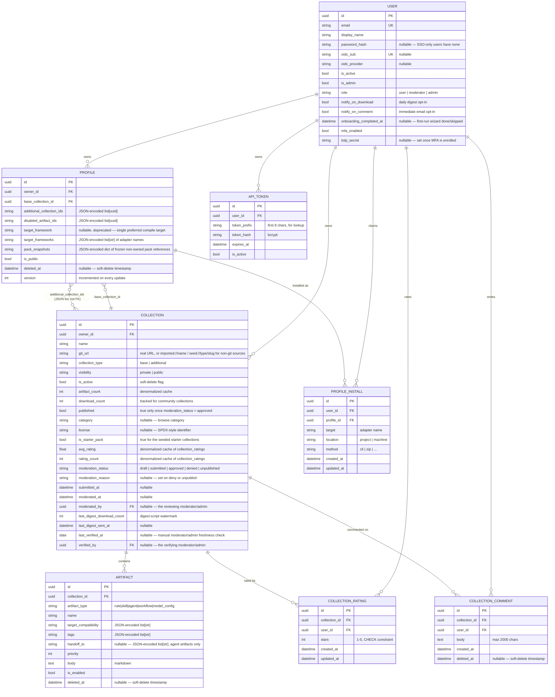

# Data Model

All tables use UUID primary keys (never auto-increment integers — see
[invariants.md](invariants.md)). Timestamps are timezone-aware
(`DateTime(timezone=True)`), stored in UTC.

## Entity relationships

`DOC_CACHE` (framework documentation cache for adapter compatibility rules)
has no relationships to the rest of the schema — it's a standalone TTL cache,
keyed by `framework` + `content_hash`.

`SYSTEM_SETTINGS` also has no relationships — it's a singleton row
(`id` always `1`) holding global, admin-editable config: which auth
providers are enabled, whether registration/MFA are allowed or forced, and
the doc cache TTL. See the `system_settings` section below.

## Tables

### `users`

The only table every other owned table has a foreign key into. A user can
authenticate via password (`password_hash`, nullable — SSO-only accounts
never set one), OIDC/GitHub/Google (`oidc_sub` + `oidc_provider`, unique
together), or both. `is_admin` bypasses ownership checks everywhere; see
[invariants.md](invariants.md#authorization). `mfa_enabled` + `totp_secret`
back TOTP-based MFA (`pyotp`) — `totp_secret` is only set once enrollment
completes via `POST /auth/me/mfa/totp/setup` + `.../verify`. `reset_token_hash`
+ `reset_token_expires_at` back password-reset-by-email (`POST
/auth/forgot-password` / `/auth/reset-password`) — only the SHA-256 hash of
the emailed token is stored, mirroring the API-token-hash pattern; the token
is single-use (both fields are cleared on a successful reset) and expires
after 1 hour.

`role` (`user`/`moderator`/`admin`, default `user`) is additive alongside
`is_admin` — see [ADR-0007](adr/0007-additive-user-role-column.md) for why
there are two fields instead of one. `is_admin` still gates every
pre-existing admin check; `role` is read only by the newer
`require_moderator_or_admin` dependency that gates the community
moderation routes. The two are kept in sync by
`PATCH /auth/users/{id}/role` (admin-only), never independently.
`notify_on_download`/`notify_on_comment` (both default `false`) are
per-user, self-service opt-ins for community-collection notification
emails — see the "Community collections" section below.
`onboarding_completed_at` (nullable) records that the first-run wizard was
finished or explicitly skipped. It is written only by `PATCH
/auth/me/onboarding` (`{"completed": true|false}`), which always touches the
calling user's own row, and is exposed on `UserRead` so the wizard never
repeats on another device. The in-progress draft stays in localStorage.

### `collections`

A named bag of artifacts. `git_url` is a real repository URL for
GitHub-imported collections, or a synthetic URI for anything that didn't
come from a real git remote — `imported://<name>` for a local scan or
bulk-exported artifacts, `imported://community/<name>` for a community
import, `seed://<collection_type>/<slug>` for the built-in starter packs
(`seed_collections.py`) — don't assume it's always dereferenceable.
`visibility` (`private`/`public`) is the only access-control dimension
beyond ownership; there is no per-collaborator sharing. `is_active` is a
soft-delete flag — deleted collections are never physically removed.
`artifact_count` is a denormalized cache updated by every route that
adds/removes artifacts (import, bulk delete, bulk export) — if you add a new
artifact-mutating route, update it there too or the count will drift.
`is_starter_pack` marks the collections seeded on every backend startup from
`collections/base/` and `collections/additional/`, owned by a dedicated
passwordless system account — see the "Starter packs" section in
`CLAUDE.md`. `avg_rating`/`rating_count` are a denormalized cache of
`collection_ratings`, recomputed transactionally on every rating
write/delete — see the `collection_ratings` section below.
`moderation_status` (`draft`/`submitted`/`approved`/`denied`/
`unpublished`) is the single source of truth for the community-publishing
lifecycle — see [ADR-0008](adr/0008-collection-moderation-state-machine.md),
[ADR-0013](adr/0013-post-hoc-unpublish.md), and the "Community collections"
section below; `published` is only ever set by the approve action, never
by submission itself. `visibility` is a separate, owner-editable
link-sharing flag (the Share dialog) that does not imply the collection
was reviewed or is listed in Community. `unpublished` is reached
from `approved` only, via the owner or a moderator/admin, and can only get
back to `approved` through a fresh submit + approval — same as `denied`.
`last_digest_download_count`/`last_digest_sent_at` are watermark fields
for the daily download-digest script
(`app/scripts/send_download_digests.py`), not exposed via the API.
`last_verified_at`/`verified_by` back manual freshness verification (Epic
4.5) — see the "Freshness verification" section below.
`license` (nullable `String(64)`) is an optional SPDX-style identifier
surfaced in the publish flow and pack detail. There is no validation beyond
the length cap — existing packs have no license, and nothing gates on it.

### `artifacts`

Belongs to exactly one collection (`collection_id`, `ON DELETE` not
configured — see [invariants.md](invariants.md#data-integrity) for what
that means in practice). Has **no `owner_id` of its own** — authorization is
always done via the parent collection. `target_compatibility` and `tags` are
JSON-encoded into `Text` columns rather than being normalized into their own
tables; every route that returns artifacts must decode them before
responding (see
[debugging.md](debugging.md#response_model-silently-strips-fields-you-didnt-declare)).
`is_enabled` is per-artifact and independent of the collection's
`is_active` — a disabled artifact is skipped during compilation unless a
profile explicitly asks to `include_disabled`. `deleted_at` supports
soft-delete — artifacts are never physically removed from the database.

`handoff_to` (nullable `Text`, JSON-encoded `list[str]`) is an optional
pipeline-routing field on **agent** artifacts only — the names of other
agents this one may hand work off to, machine-readable alongside the
prose "## Handoff" section agent bodies already document by convention.
`NULL` means "not declared"; `[]` (an empty JSON array) means "declared,
but terminal — never hands off"; the two are kept distinct rather than
collapsing to one falsy default the way `tags`/`target_compatibility` do.
See [ADR-0010](adr/0010-structured-handoff-field.md) for why this is a
field on the existing `artifacts` table rather than a new join table, and
[debugging.md](debugging.md#my-handoff_to-reference-doesnt-resolve-dangling_handoff)
for how `compile_profile()`'s `dangling_handoff` validation pass (reusing
the compile-time warnings plumbing introduced for `name_collision`)
surfaces a `handoff_to` entry naming an agent absent from the compiled
artifact set, rather than silently accepting it.
`POST /collections/{collection_id}/artifacts` (added alongside this
field) is the only way to create a single artifact directly — every
other creation path is bulk (import/scan-derived).

### `collection_ratings`

One row per (collection, user) — enforced by a DB-level unique constraint
(`uq_collection_ratings_collection_user`), not just upsert logic in the
route handler. `stars` has a `CHECK (stars >= 1 AND stars <= 5)`
constraint in addition to the 422 the API returns for an out-of-range
value. `PUT /collections/{id}/rating` upserts the caller's own row and
recomputes `Collection.avg_rating`/`rating_count` transactionally; `DELETE`
removes it and recomputes again. Rating requires
`Collection.moderation_status == "approved"` and blocks self-rating
(`owner_id == current_user.id` → 400).

### `collection_comments`

Soft-deleted (`deleted_at`), never hard-deleted, per the soft-delete rule
below. `body` is capped at 2000 characters, enforced at the Pydantic
schema layer (`CollectionCommentCreate`), not just informally. Commenting
requires `Collection.moderation_status == "approved"`, same gate as
ratings. Deletion is allowed for the comment's own author, the
collection's owner, or a moderator/admin — checked in the route handler,
not by a DB constraint. `GET /collections/{id}/comments` still requires
authentication like every other route in this API (see
[invariants.md](invariants.md#authorization)) — the plan that introduced
comments described this endpoint as public, but that would have been the
first unauthenticated data route in the app, so it was kept consistent
with the existing all-routes-require-auth convention instead.

### `profiles`

`base_collection_id` is a real foreign key; `additional_collection_ids` and
`disabled_artifact_ids` are **not** — they're JSON-encoded UUID lists,
resolved and validated at request time rather than enforced by the database.
This means the database will happily store a profile referencing a
collection that's since been deleted or made private; `compile_profile()`
now falls back to a reference snapshot or emits a `pack_unavailable`
warning instead of skipping silently (see below and
[ADR-0015](adr/0015-pack-reference-freeze.md)). `version` increments on every
`PUT` — there's no history table, just the counter.

`target_framework` (nullable, deprecated) is the old single-value "preferred
target" hint. It is still read and written for compatibility but no longer
drives anything; `target_frameworks` (JSON-encoded `list[str]`, default
`"[]"`) is the new field, exposed on `ProfileRead`/`ProfileCreate`. The
migration backfills `[target_framework]` for every row that had a non-null
legacy value. Values are filtered against the registered adapter names on
write — unknown values are dropped silently rather than 422'd, so an admin
disabling an adapter can never brick an existing setup. The actual compile
target is still chosen per-compile-request; this list is what the UI shows as
"installed on these frameworks" and what the install panel pre-fills.

`pack_snapshots` (JSON-encoded `Text`, default `"{}"`) is the reference
freeze: `{collection_id: {"artifact_ids": [...], "hash": "<sha256>",
"captured_at": "<iso8601>"}}`. It is captured/refreshed on profile create
and update **only for referenced collections the requesting user does not
own and can still read** — an owned collection is always readable, so
freezing it would add nothing. A referenced collection the user can no
longer read keeps its existing frozen snapshot (it is never re-read), and a
profile update only read-checks **newly added** collection ids, so a setup
whose pack went private stays editable.
`compile_profile()` falls back to these artifact ids when a referenced
collection is missing, inactive, or unreadable — but only for an allowed
viewer (`requesting_user is None`, the profile's owner, or an admin). Any
other requester gets `pack_unavailable` and the pack is skipped, so a public
profile cannot become a redistribution channel for a pack that was
unpublished. The warning is emitted either way (with or without a
snapshot). Artifacts are soft-deleted at most (rule 15), so a frozen id still
resolves; a later soft-delete of the pack does not remove it from the frozen
set. This is the one deliberate compile-time authorization bypass, scoped to
ids the profile owner already had access to at capture time — see
[ADR-0015](adr/0015-pack-reference-freeze.md).

`is_public` is the profile's own
visibility flag, independent of the visibility of the collections it
references (see the documented gap in
[invariants.md](invariants.md#a-gap-thats-accepted-not-fixed)). `deleted_at`
supports soft-delete — profiles are never physically removed from the
database.

### Compile-time validation warnings (response-only — no table)

`POST /profiles/compile`'s response carries a `warnings` field
(`list[ValidationIssue]`, each `{level: "warning", code: str, message:
str}` — `app/models/profile.py`), additive to the pre-existing
`{profile_id, profile_name, target, artifact_count, files}` shape.
`compile_profile()` (`app/services/compiler.py`) computes these fresh on
every call, in the same step that deduplicates artifacts by name — nothing
here is persisted to the database, there's no `validation_issues` table,
and no migration was needed to add it. `POST /profiles/compile/zip` can't
embed this JSON alongside the zip's binary response, so it instead appends
a `_myace_warnings.txt` file inside the archive when there are any
warnings to report. See [AGENTS.md rule 32](../AGENTS.md) for the
name-collision rule this currently powers. The `{level, code, message}`
shape is deliberately generic rather than name-collision-specific, so a
future compile-time check (e.g. a dangling agent-handoff reference) can
append its own `code` to the same `warnings` list without a schema change
or a second parallel warnings mechanism.

The same response also now carries `compiled_hash: str` — a sha256 over a
deterministic serialization of `files` (`compute_compiled_hash()`, same
codebase). This, too, is response-only: nothing is persisted, and it's
recomputed fresh on every compile. `GET /profiles/{id}/compile-status`
returns just `{compiled_hash, updated_at}` for the same profile+target
without the full `files` payload — see
[ADR-0009](adr/0009-manifest-based-drift-detection.md) for why this
exists (cheap polling for the CLI's `check`/`watch` commands) and its
honestly-documented cost trade-off (it still resolves artifacts and runs
`translate()`; it only saves the client the transfer cost of file
content, not the server's compute cost).

### Freshness verification

See [ADR-0012](adr/0012-manual-collection-freshness-verification.md) for
why this is a manual, moderator-attested signal rather than an automated
content check. `Collection.last_verified_at` (nullable `Date`) and
`verified_by` (nullable FK to `users.id`) record that a moderator/admin
manually looked at a
collection recently and confirmed it's still good — not that anything was
automatically checked against live tool documentation; the frontend badge
copy (`FreshnessBadge.tsx`) and API docstrings both say so explicitly, to
avoid the field implying more rigor than it has. `GET
/admin/freshness-queue` (`app/api/freshness.py`, gated by
`require_moderator_or_admin`) lists approved, active community collections
where `last_verified_at IS NULL OR last_verified_at < today -
settings.collection_freshness_threshold_days` (default ~6 months),
never-verified first. `POST /collections/{id}/verify` (same gate) sets both
fields to "today" / the calling moderator's id — there is no
self-verification block the way moderation has a self-approval block
(rule 30/AGENTS.md rule 37), since verifying is additive/non-destructive in
a way approving a submission isn't.

`app/scripts/check_collection_freshness.py` is a weekly cron script (same
"no in-process scheduler" shape as `send_download_digests.py`, see
`docs/deployment.md`) that emails every active moderator/admin a digest
when the stale count is greater than zero, reusing the exact query the API
route uses (`stale_collections_query()`) so the two can't drift apart on
what counts as stale.

### Public demo compile (no table, no persistence at all)

`POST /demo/compile` (`app/api/demo.py`, see
[ADR-0011](adr/0011-public-demo-sandbox.md)) is unrelated to every table on
this page — it has no DB session dependency at all, so there's structurally
nothing it could persist to even by accident. Caller-supplied markdown is
parsed into ephemeral `CanonicalArtifact` objects that exist only for the
duration of the request/response cycle. This is a stronger guarantee than
the "response-only" compile-time-warnings feature above (which still runs
inside the normal `/profiles/compile` pipeline, reading real `Collection`/
`Artifact` rows even though it writes nothing new) — the demo endpoint
touches the database in neither direction.

### `sync_statuses`

Opt-in only — a row here exists exclusively because a user ran `myace
check --report` or `myace watch --report` from some machine; nothing is
written here automatically by `pull`, `check`, or `watch` in their default
form (see [ADR-0009](adr/0009-manifest-based-drift-detection.md)).
`user_id` and `profile_id` are real foreign keys; `target` and
`machine_label` are free strings (the latter defaults to the reporting
machine's hostname but is otherwise arbitrary user-supplied text, not
validated against anything). `locally_modified_files` is a JSON-encoded
`Text` column, same pattern as `Artifact.tags` (AGENTS.md rule 11) — always
converted through `SyncStatusRead` before leaving a route, never returned
as a raw row. A unique constraint on `(user_id, profile_id, target,
machine_label)` makes `POST /sync/report` an upsert: a second report for
the same triple updates `in_sync`/`locally_modified_files`/
`last_checked_at` on the existing row rather than inserting a duplicate.
`GET /sync/status` only ever returns the caller's own rows — there is no
cross-user visibility here, not even for admins (this is personal local-
machine state, not a community feature); see
[invariants.md](invariants.md).

### `profile_installs`

A user's *claim* that they installed a profile to a target at a location —
never verification. `SyncStatus` (fed by `myace check --report`) remains the
only verified source of "the files on disk match the compiled output"; a row
here only means the user said "I installed this". Four columns identify a
claim: `user_id`, `profile_id`, `target` (adapter name), `location`
(`project`/`machine`), with a unique constraint on that tuple so `POST
/profiles/{id}/installs` upserts rather than duplicating; `method` (e.g.
`cli`/`zip`) is descriptive. `GET /profiles/{id}/installs` returns only the
caller's own rows — like `sync_statuses`, this is personal local-machine
state, not a community feature, so it is never visible to another user (not
even an admin). Both routes authorize reading the parent profile via the
existing profile rule (owner or public), and `target` reuses `CompileTarget`
so an unknown adapter is a 422. See
[ADR-0015](adr/0015-pack-reference-freeze.md) and the "Install claims are
not verification" invariant.

### `api_tokens`

CLI authentication. The raw key is generated once, split into an 8-char
`token_prefix` (stored in plaintext, used to narrow the lookup) and the full
key (bcrypt-hashed into `token_hash`). The raw key is returned to the caller
exactly once, at creation — the database never stores it in recoverable
form. `expires_at` is enforced in `get_current_user`; there's no background
job that revokes expired tokens, they just stop authenticating.

### `doc_cache`

Unrelated to the auth/ownership model above — a TTL-based cache of fetched
framework documentation, used by adapter compatibility checks. Not
owner-scoped; it's shared, read-only reference data. `deleted_at` supports
soft-delete — cache entries are never physically removed from the database.

### `system_settings`

A singleton row (`id` is always `1`, enforced by convention rather than a
DB constraint) holding global, admin-only config: which auth providers
(`oidc_enabled`/`github_enabled`/`google_enabled`) and registration
(`allow_registration`) are turned on, whether MFA is available
(`mfa_enabled`) or mandatory (`mfa_forced`), and `doc_cache_ttl_days`. Read
via `GET /admin/settings`, written via `PATCH /admin/settings`
(`SystemSettings.tsx`) — both admin-gated. Not owner-scoped; there is
exactly one row.

Also holds the SMTP config used for password-reset emails: `smtp_enabled`,
`smtp_host`, `smtp_port`, `smtp_username`, `smtp_from_email`,
`smtp_from_name`, `smtp_use_tls`, and `smtp_password_encrypted` (the
admin-entered password, Fernet-encrypted — see
[ADR-0006](adr/0006-encrypted-admin-editable-secrets.md)). Any of these left
unset falls back to the matching `SMTP_*` env var at runtime
(`app/services/effective_settings.py`); a non-empty DB value always wins.
`SystemSettingsRead` never returns `smtp_password_encrypted` itself — only a
computed `smtp_password_set: bool` — and `SystemSettingsUpdate` accepts a
plaintext, write-only `smtp_password` field that the `PATCH /admin/settings`
handler encrypts before persisting.

Also holds per-provider OAuth credentials — `oidc_client_id`,
`oidc_client_secret_encrypted`, `oidc_issuer_url`, `oidc_scopes`,
`github_client_id`, `github_client_secret_encrypted`, `google_client_id`,
`google_client_secret_encrypted` — entered via System Settings' expandable
Authentication Providers rows instead of only `.env`. Same precedence and
encryption contract as SMTP above (`get_effective_oauth_config()` in
`effective_settings.py`; `{provider}_client_secret_set` computed booleans,
never the encrypted value, on `SystemSettingsRead`). `security.py`'s
`get_oauth_client()` rebuilds a provider's Authlib client whenever its
effective config changes (tracked by a fingerprint), so a credential saved
here takes effect on the next login/callback request without a restart.

Also holds `disabled_adapters` — a JSON-encoded `list[str]` of adapter
names (`BaseAdapter.adapter_name()`) an admin has disabled system-wide,
same manual-JSON-in-`Text`-column convention as
`Profile.disabled_artifact_ids`. Toggled via `PATCH
/admin/adapters/{name}?enabled=<bool>`. Enforced in two places: the
frontend's compile target picker (`TargetExporter.tsx`) filters disabled
adapters out of the dropdown, and `compile_profile()`
(`app/services/compiler.py`) — the single choke point both
`/profiles/compile` and `/profiles/compile/zip` funnel through — raises
`AdapterDisabledError` (→ HTTP 400) if the requested `target` is disabled,
so the restriction can't be bypassed by calling the API directly.

## Why JSON-as-text instead of proper junction tables

`Collection.tags`/`target_compatibility` and `Profile.additional_collection_ids`/`disabled_artifact_ids`
could be normalized into join tables. They're JSON-in-text instead because:

- These lists are always read/written as a whole (never queried
  element-wise — nothing does "find all artifacts tagged X" at the SQL
  level today).
- It keeps the schema small for what is, so far, a single-user-per-resource
  data model with no need for relational queries across these lists.

## Community collections

Publishing goes through a moderation queue, not a self-serve DB write — see
[ADR-0008](adr/0008-collection-moderation-state-machine.md) for the full
state machine. `POST /collections/{id}/publish` moves a collection from
`draft`/`denied` to `submitted`; only the moderator/admin-only
`POST /moderation/{id}/approve` action flips `published = True` and
`visibility = "public"`. `GET /collections/community` lists anything with
`published = True AND is_active = True` (unchanged query, but now that
predicate is only ever true for `moderation_status = "approved"` rows) and
accepts `sort=rating|downloads|alpha` (default `downloads`).
`GET /moderation/queue` (moderator/admin only) lists `submitted` rows,
oldest-first by default, accepting the same three `sort` values as an
override. `download_count` is the "used N times" counter — incremented by
community import (a fork) and by `POST /collections/{id}/use` (a reference,
once per call, with no per-user dedupe — see invariant 25); it is advisory,
not a verified metric. `category` is a free-text browse string, and
`license` is an optional SPDX-style string (`String(64)`, no validation) set
by the publish wizard before submission.

The community read surface is **anonymous** (ADR-0014): `GET
/collections/community`, `/community/top`, `/community/categories`,
`/community/{id}` and `/community/{id}/artifacts` require no session. Detail
and contents routes return only active + published + approved rows (404
otherwise) and the contents route exposes enabled items only; all five are
rate-limited per client IP by `storefront_limiter`. They serialize through
`PublicCollectionRead`, not `CollectionRead`, so `git_url`/`git_branch`,
`visibility`, and the moderation-workflow fields never reach an anonymous
client. `download_count` remains
advisory — the storefront shows it as "used N times" and never offers a
"Most used" sort or ranking.

Denying (`POST /moderation/{id}/deny`, body `{reason}`) sets
`moderation_status = "denied"` and `moderation_reason`, leaves
`published = False`, and lets the owner edit and resubmit (back to
`submitted`). A moderator/admin can also fix `name`/`description`/
`category` directly via `PATCH /moderation/{id}/meta`, regardless of
`moderation_status` — never `git_url`/`git_branch`/artifact content, and
never available to the collection's own owner (they use their existing
`PATCH /collections/{id}` instead).

`POST /collections/{id}/unpublish` (owner *or* moderator/admin, only from
`approved`) sets `published = False`, `visibility = "private"`,
`moderation_status = "unpublished"`, and reuses `moderation_reason`/
`moderated_at`/`moderated_by` — see
[ADR-0013](adr/0013-post-hoc-unpublish.md). Unlike `publish`/`approve`/
`deny`, this one is deliberately available to both the owner and a
moderator/admin, since pulling stale or reported content shouldn't require
waiting on whichever side didn't notice first. Getting back to `approved`
still requires a fresh `publish` + moderator approval, same as `denied`.
`GET /collections/{id}` (and its artifacts routes) also allow read access
to a non-admin moderator once `moderation_status != "draft"`, so they can
actually open a submission's contents to review it, not just its queue-row
metadata — see rule 40 in `AGENTS.md`.

This is entirely separate from the seeded starter-pack set (`is_starter_pack
= True`, owned by the system account — see the `collections` table above):
starter packs are grandfathered straight to `moderation_status = "approved"`
at seed time, never routed through the queue. The migration that introduced
`moderation_status` did the same one-time grandfathering for every
collection that was already `published = True AND is_active = True`,
matching this exact query's filter — nothing already visible in the
community disappeared or needed re-review.

Importing a community collection creates a new user-owned `Collection` with
copied `Artifact` rows and increments `download_count` on the source. If the
source owner has `notify_on_download = True`, they get a daily digest
email (not a per-download email) — see `last_digest_download_count`/
`last_digest_sent_at` in the `collections` table above and
`docs/deployment.md`'s cron entry for `app/scripts/send_download_digests.py`.
Comment creation on an approved collection emails the owner immediately
instead (comments are much lower-volume than downloads) if
`notify_on_comment` is on and they have an email on file.

If a future feature needs to query inside these lists (e.g. "find all public
collections tagged `python`"), that's the point to normalize — don't
work around it with `LIKE '%...%'` queries on the JSON text.
